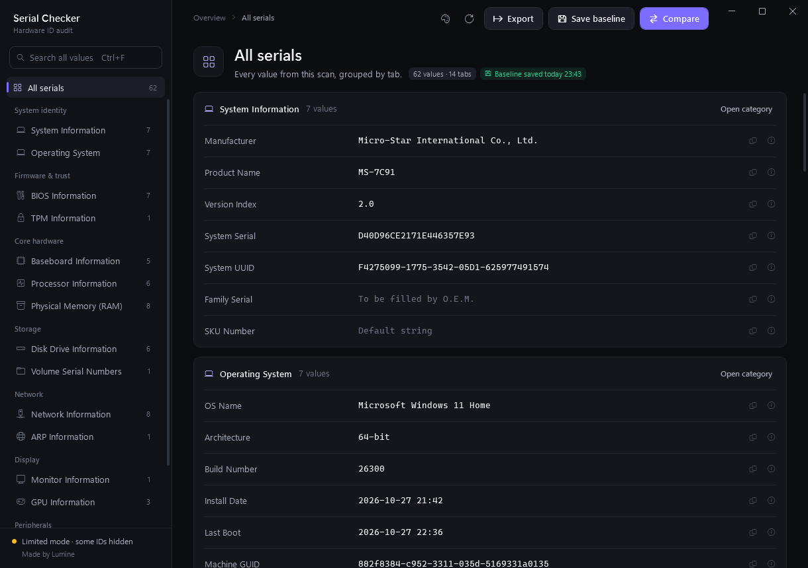
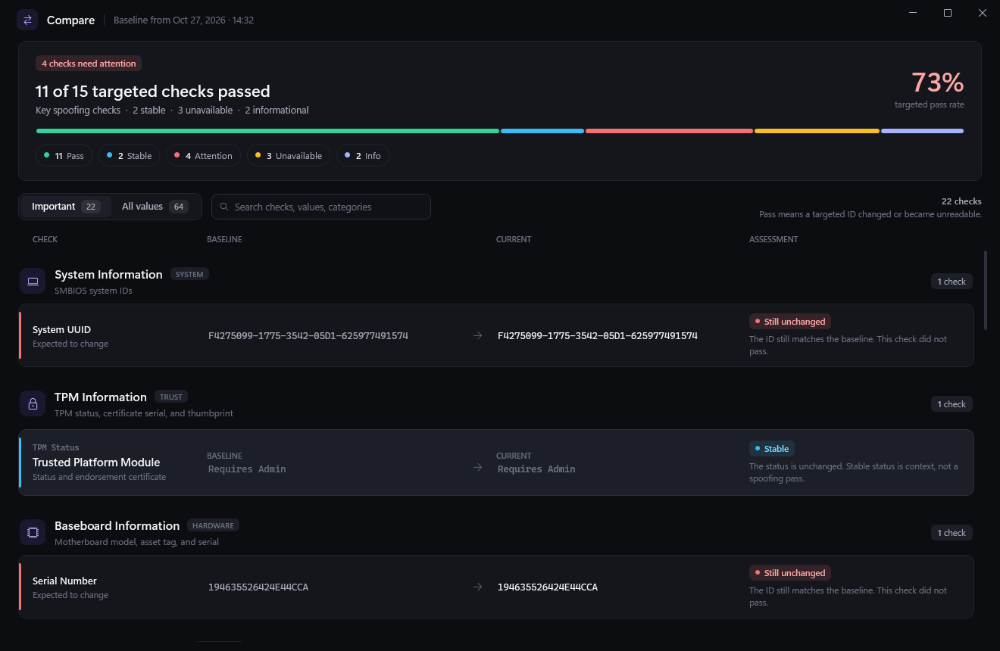
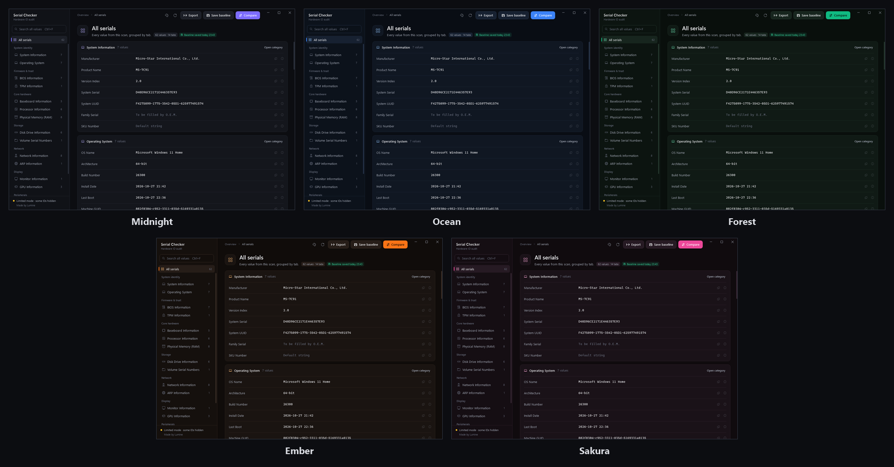

# Serial Checker

Check whether your hardware serials are really spoofed. Serial Checker reads IDs straight from the hardware (IOCTL disk queries, the TPM endorsement key, SMBIOS, and monitor EDID) instead of trusting WMI alone. It then compares them against a baseline you saved earlier.

**[Download the latest release](../../releases/latest)** · Windows 10 / 11 x64 · one self-contained `.exe`, no install needed



## What it checks

| Area | Values |
|---|---|
| **System identity** | SMBIOS manufacturer, product, system serial, UUID, family, SKU; Windows install details, Machine GUID, Product ID |
| **Firmware & trust** | BIOS vendor, version, serial; Core Isolation, virtualization, Secure Boot; TPM status, manufacturer, endorsement-key certificate serial and thumbprint |
| **Core hardware** | Baseboard serial and asset tag, processor IDs, RAM module serials |
| **Storage** | Drive serials through five query paths (`STORAGE_QUERY_PROPERTY`, `SMART_RCV_DRIVE_DATA`, VPD WWN, SCSI pass-through, ATA pass-through) and volume serials |
| **Network** | Active (spoofable) MAC, burned-in kernel MAC, DHCP/DNS, ARP table |
| **Display** | Monitor EDID serials, GPU PCI IDs and NVIDIA UUID |
| **Peripherals** | Real USB serials, including disconnected ("ghost") devices left in the registry |

Unsupported queries show `00000000` instead of a made-up value, so a spoofer that blocks a query shows up as blocked.

## How to use it

1. Open **All serials** and click **Save baseline** to record every tab. Inside a single tab the button becomes **Save tab baseline** and updates only that tab.
2. Run your spoofer, swap a device, change a MAC, or make whatever change you're testing.
3. Click **Compare**. Serial Checker scans again and checks every tab that has a saved baseline.



Each check gets one of five results:

| Result | Meaning |
|---|---|
| **Pass** | An ID that should change did change, or became unreadable |
| **Attention** | An ID that should change is still the same, or a value that should stay put changed |
| **Stable** | A value that should stay the same did |
| **Unavailable** | Neither scan could read a usable value |
| **Info** | Context only; no verdict |

## Features

- **Search** across every value (Ctrl+F), with jump-to-tab results
- **Five colour themes:** Midnight, Ocean, Forest, Ember, Sakura, remembered between launches
- **Copy** any value with one click, or select it directly
- **Export** a full text report to your Desktop (Ctrl+E)
- **Ghost USB cleanup:** remove records of devices that are no longer connected
- **Fast:** all checks run in parallel



### Keyboard shortcuts

| Keys | Action |
|---|---|
| Ctrl+F | Search all values |
| F5 | Scan again |
| Ctrl+S | Save baseline (all tabs, or the current tab) |
| Ctrl+E | Export report |
| Esc | Clear search / close Compare |

## Privacy and permissions

- **Nothing leaves your PC.** Serial Checker makes no network requests.
- **Saved files:** baselines and settings are stored in `%AppData%\Serial Checker`. Exports go to your Desktop.
- **Admin rights:** the app asks for administrator rights on launch, because TPM, some disk queries, and network adapter details need them. Start it with `--no-elevate` to skip the prompt and run in limited mode.

## Building from source

Requires the [.NET 10 SDK](https://dotnet.microsoft.com/download/dotnet/10.0) on Windows.

```
dotnet build
dotnet run
```

Single-file release build:

```
dotnet publish SerialChecker.csproj -c Release -p:PublishProfile=WinX64 -o artifacts
```

### Releasing

Bump `<Version>` in `SerialChecker.csproj`, update `RELEASE_NOTES.md`, and push to `main`. The **Release Windows executable** workflow builds `SerialChecker-<version>.exe`, adds a SHA-256 checksum, and publishes the GitHub release.

## License

Serial Checker is free software under the [GNU General Public License v3.0](LICENSE). It is a modified and rebranded version of the open-source **spoofed?** project; the 2.0.0 redesign is by Lumine.

Made by Lumine.
